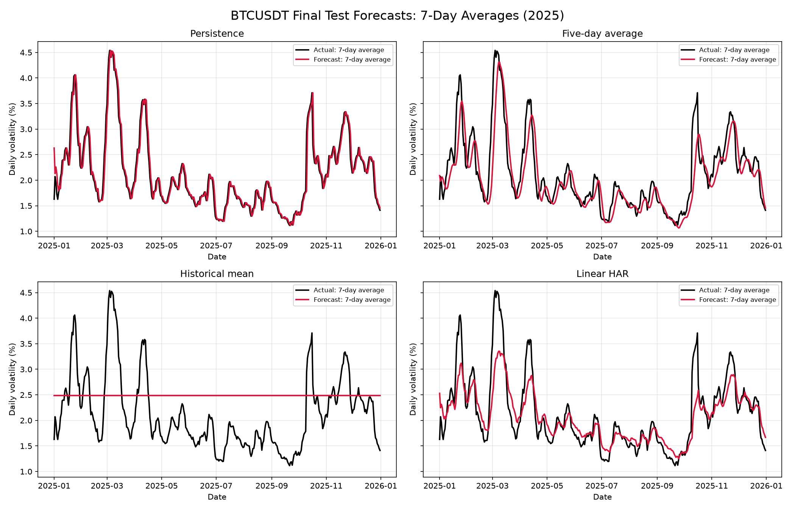
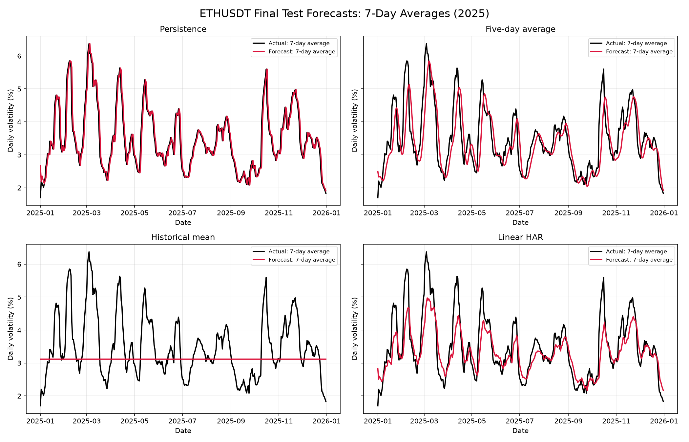
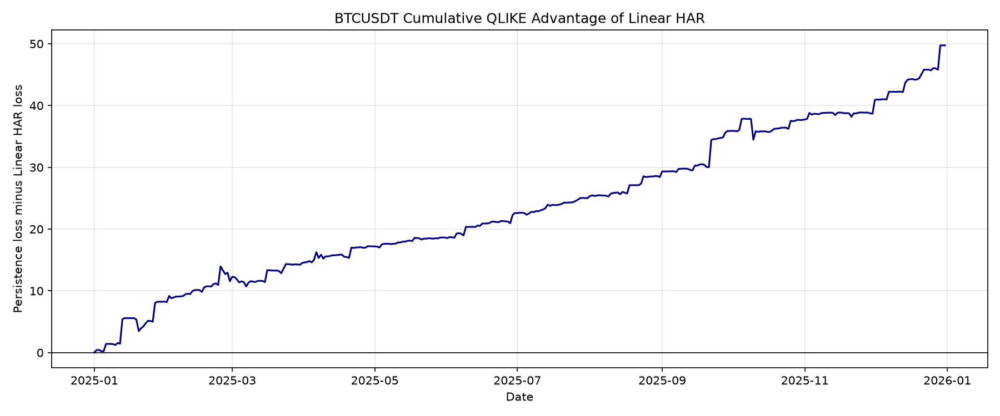
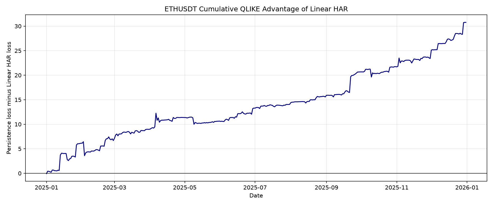

# Daily cryptocurrency volatility forecasting

## Objective

This project forecasts the next UTC day's realized variance for Bitcoin and
Ethereum. It predicts the size of future price movements, not whether prices
will rise or fall.

## Data

The data consist of Binance spot-market five-minute candles for BTC/USDT and
ETH/USDT from January 2020 through December 2025. Every downloaded monthly ZIP
file was checked against Binance's published SHA-256 checksum.

Five-minute log returns were squared and summed within each UTC day to obtain
daily realized variance. Daily realized volatility is the square root of that
variance. A day was accepted only when it contained 288 bars and 288 valid
five-minute returns. Missing intervals were not filled.

- BTC complete days: 2,176
- ETH complete days: 2,176
- Incomplete days per asset: 16
- Average BTC daily volatility: 2.89%
- Average ETH daily volatility: 3.75%

## Forecast features

The forecasting target is today's log realized variance. Every predictor uses
information ending on the previous calendar day:

- previous day's log realized variance;
- mean log realized variance over the previous 5 calendar days;
- mean log realized variance over the previous 22 calendar days.

The data were shifted before rolling averages were calculated. Incomplete dates
remain in the calendar and invalidate rolling windows containing them. This
produced 1,885 usable target dates for each asset.

## Evaluation design

- Training: 24 January 2020 through 31 December 2023, 1,154 rows
- Validation: 1 January through 31 December 2024, 366 rows
- Test: 1 January through 31 December 2025, 365 rows

Model choice used validation data only. Linear HAR had the lowest 2024
validation QLIKE for both assets and was frozen before the test evaluation. It
was then refitted on training plus validation data, ending on 31 December 2024.

The comparison models were persistence, a five-day average, the historical
training mean, and linear HAR. Lower log-MSE, log-MAE, and QLIKE are better.

## Validation results

| Asset | Selected model | Log-MSE | Log-MAE | QLIKE |
|---|---|---:|---:|---:|
| BTC | Linear HAR | 0.5466 | 0.5487 | 0.3082 |
| ETH | Linear HAR | 0.4675 | 0.5064 | 0.2919 |

## Final 2025 test results

| Asset | Model | Log-MSE | Log-MAE | QLIKE | QLIKE improvement vs persistence |
|---|---|---:|---:|---:|---:|
| BTC | Linear HAR | 0.6006 | 0.5676 | 0.3553 | 27.72% |
| ETH | Linear HAR | 0.4806 | 0.5144 | 0.3029 | 21.77% |

Linear HAR had lower point-estimate losses than all three benchmarks for both
assets in the final test year. This is an out-of-sample forecasting result, not
evidence of causation or guaranteed future performance.

## Uncertainty analysis

Paired daily loss differences were evaluated with a seven-day moving-block
bootstrap using 5,000 resamples. A positive difference means Linear HAR had
lower loss. The 95% QLIKE intervals against persistence were:

| Asset | Mean QLIKE improvement | 95% interval | Interval excludes zero |
|---|---:|---:|---:|
| BTC | 0.1362 | [0.0871, 0.1799] | True |
| ETH | 0.0843 | [0.0449, 0.1207] | True |

The evidence against persistence is comparatively strong under this bootstrap
design. However, BTC's QLIKE advantage over the historical-mean benchmark has a
95% interval of [-0.0303,
0.1948], which includes zero.
Therefore, the results do not support claiming that every observed improvement
is statistically clear.

## Limitations

- The final evaluation covers one historical year and two assets from one exchange.
- The seven-day bootstrap block length is a modelling choice; other block lengths may change the intervals.
- Exponentiating a log-variance prediction is a simple conversion and may be biased for mean variance without a retransformation correction.
- Coefficients were fixed for the test year rather than repeatedly refitted.
- Forecast accuracy does not by itself demonstrate economic or trading value.
- The 2025 test period has now been examined and must not be reused as an untouched test set for additional tuning.

## Conclusion

The simple linear HAR model provided a reproducible improvement over persistence
for both Bitcoin and Ethereum in the 2025 test period. The improvement remained
positive in the paired block-bootstrap intervals against persistence. The result
supports volatility persistence across daily, short-term, and longer-term
horizons, while the stated limitations prevent broader claims about universal
superiority or future profitability.
